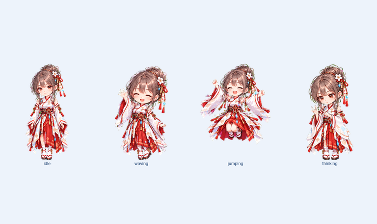
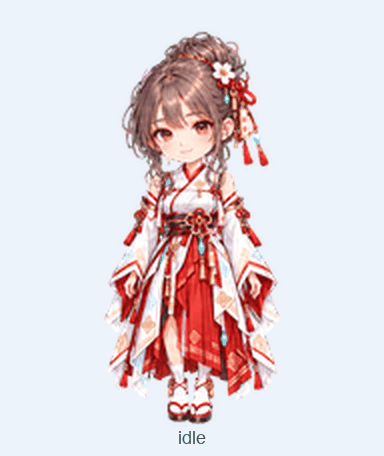
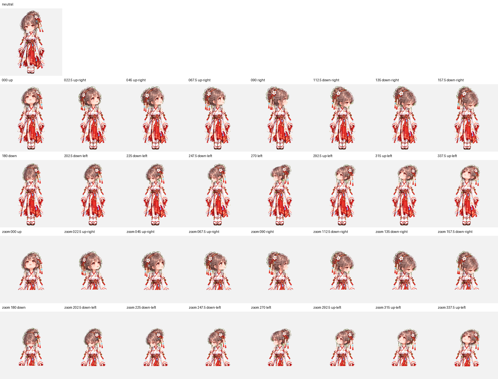

# Codex Pet — Rin Miko

[English](README.en.md) | 日本語

Rin Miko（未来巫女・りん）は、Codex Desktopで使える非公式のカスタムPetです。リンを、白と朱の未来巫女装束、桜の髪飾り、青い結晶をまとったちびキャラクターとして仕上げています。

> [!IMPORTANT]
> **個人・非商用のローカル利用のみ許可されています。再配布禁止です。** GitHub標準の閲覧・forkと正規リポジトリへのリンク共有を除き、転載、再アップロード、ミラー、同梱、商用利用、素材抽出、視覚素材の改変・派生利用、AI学習利用は禁止されています。詳細は[個人利用ライセンス](LICENSE.md)と[利用ガイド](docs/LICENSE_GUIDE.md)を確認してください。



## 特徴

- Codex Pet v2形式（`spriteVersionNumber: 2`）
- 9種類の標準アニメーション
- 16方向の視線アニメーション
- 透明背景のWebPスプライトシート
- 1セル `192 × 208 px`、全体 `1536 × 2288 px`
- 構造・透過・方向表現を検証済み

## インストール

macOSまたはLinuxでは次を実行します。

```sh
git clone https://github.com/momuandteasteam/CodexPets-Rin-Miko.git
cd CodexPets-Rin-Miko
./scripts/install.sh
```

Windowsでは`.\scripts\install.ps1`を使用できます。Codex Desktopを再起動し、Petの選択画面から「未来巫女・りん」を選んでください。詳しい手順と更新・削除方法は[インストールガイド](docs/INSTALLATION.md)にあります。

> [!NOTE]
> このパッケージはCodex DesktopのローカルPet形式を対象としたコミュニティ提供のものです。アプリ更新により対応形式が変わる可能性があります。

## アニメーション




| 状態 | 内容 |
|---|---|
| Idle | 静かな呼吸と待機 |
| Running right / left | 画面内を左右に移動 |
| Waving | 手を振って挨拶 |
| Jumping | 軽やかなジャンプ |
| Failed | 失敗時のリアクション |
| Waiting | ユーザー入力を待つ仕草 |
| Running | タスクを進めている集中状態 |
| Review | レビュー中の注視 |
| Look directions | 16方向の連続した視線移動 |

詳しい行構成は[アニメーション仕様](docs/ANIMATION_SPEC.md)を参照してください。

## 品質確認

最終スプライトシートは以下を確認済みです。

- `1536 × 2288 px`、8列 × 11行
- v2マニフェストとの整合
- 使用セル・未使用セルの構造
- 透明背景とクロマ残留
- 16方向の意味と連続性
- 全標準アニメーションのフレーム検査

検証結果と既知の軽微な注意点は[QAレポート](docs/QA.md)にまとめています。



## リポジトリ構成

```text
.
├── assets/                  # プレビューとアニメーションGIF
├── docs/                    # 導入・仕様・QA文書
├── pet/                     # インストール可能なPetパッケージ
├── qa/                      # 機械検証結果
└── scripts/                 # インストール補助スクリプト
```

## ライセンス

このリポジトリはオープンソースではありません。個人・非商用のローカル利用に限って許可され、再配布は禁止されています。GitHub上のforkとコントリビューションに関する限定的な扱いを含む正式な条件は[LICENSE.md](LICENSE.md)、具体例は[利用ガイド](docs/LICENSE_GUIDE.md)をご確認ください。

CodexおよびOpenAIはOpenAIの商標です。本プロジェクトは非公式のコミュニティプロジェクトであり、OpenAIによる承認・提携を示すものではありません。

## 関連文書

- [インストールガイド](docs/INSTALLATION.md)
- [アニメーション仕様](docs/ANIMATION_SPEC.md)
- [QAレポート](docs/QA.md)
- [ライセンス利用ガイド](docs/LICENSE_GUIDE.md)
- [クレジット](CREDITS.md)
- [コントリビューションガイド](CONTRIBUTING.md)
- [セキュリティポリシー](SECURITY.md)
- [変更履歴](CHANGELOG.md)
